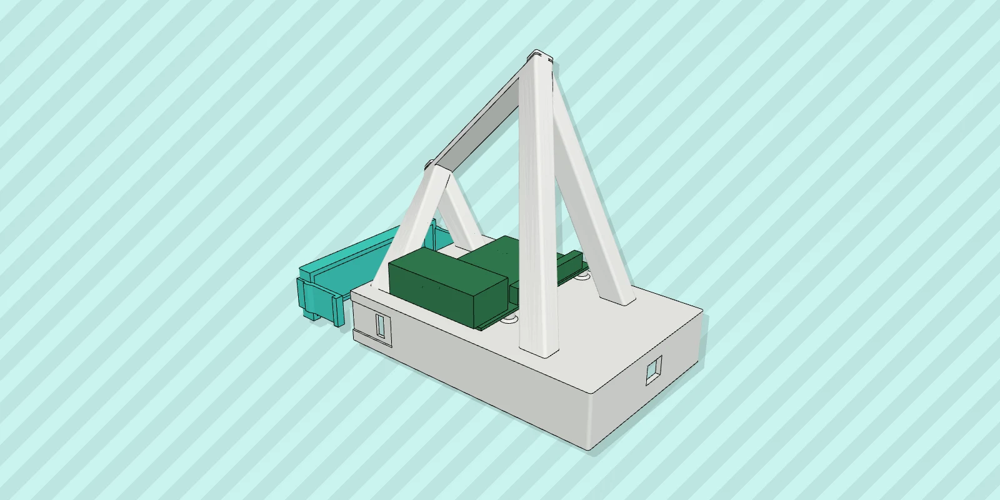

# CAD-Files

CAD models of my 3D-printing and maker projects. Each project has its own folder with the original CAD file and a STEP export, so you can open it in FreeCAD or any other CAD program.

## Projects

| Folder | Description | Files |
|---|---|---|
| [`neptune3-pro-screen-holder`](neptune3-pro-screen-holder) | Cabinet holder for the ELEGOO Neptune 3 Pro touch screen, with a Raspberry Pi 4 mount on the back | FreeCAD, STEP |

## Neptune 3 Pro screen holder

A holder for the detachable touch screen of the ELEGOO Neptune 3 Pro. The screen sits in a tray that is mounted to a cabinet with an A-frame bracket. A Raspberry Pi 4 running OctoPrint mounts on the back.

- **Tray:** open pocket for the screen with a cable opening in the side wall, about 172 × 95 mm
- **End cap:** separate part with snap hooks that click into windows in the tray's side walls
- **Raspberry Pi mount:** four standoffs on the Raspberry Pi 4 hole pattern (58 × 49 mm) with 2.2 mm holes for M2.5 screws

| File | Contents |
|---|---|
| [`Schrankhalterung_v4.FCStd`](neptune3-pro-screen-holder/Schrankhalterung_v4.FCStd) | FreeCAD source file: tray, end cap and a Raspberry Pi 4 placeholder |
| [`Schrankhalterung_v4.step`](neptune3-pro-screen-holder/Schrankhalterung_v4.step) | STEP export of the same three bodies, for any CAD program |
| [`preview.webp`](neptune3-pro-screen-holder/preview.webp) | Render of the assembly |

The Raspberry Pi in the files is only a placeholder to check clearances. Don't print it.
